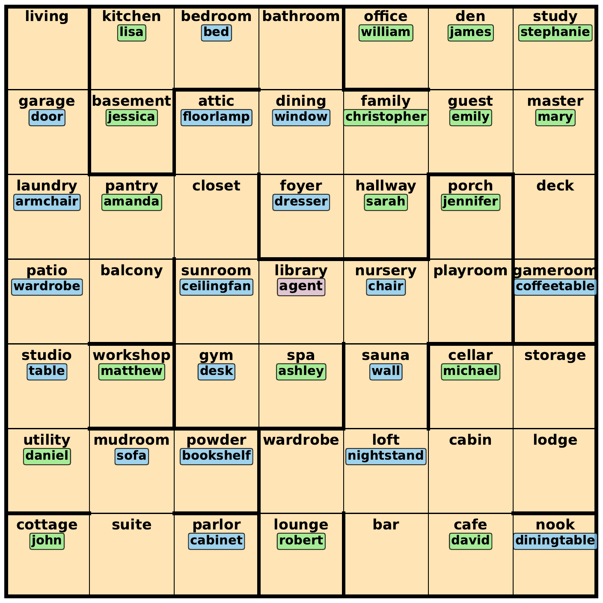
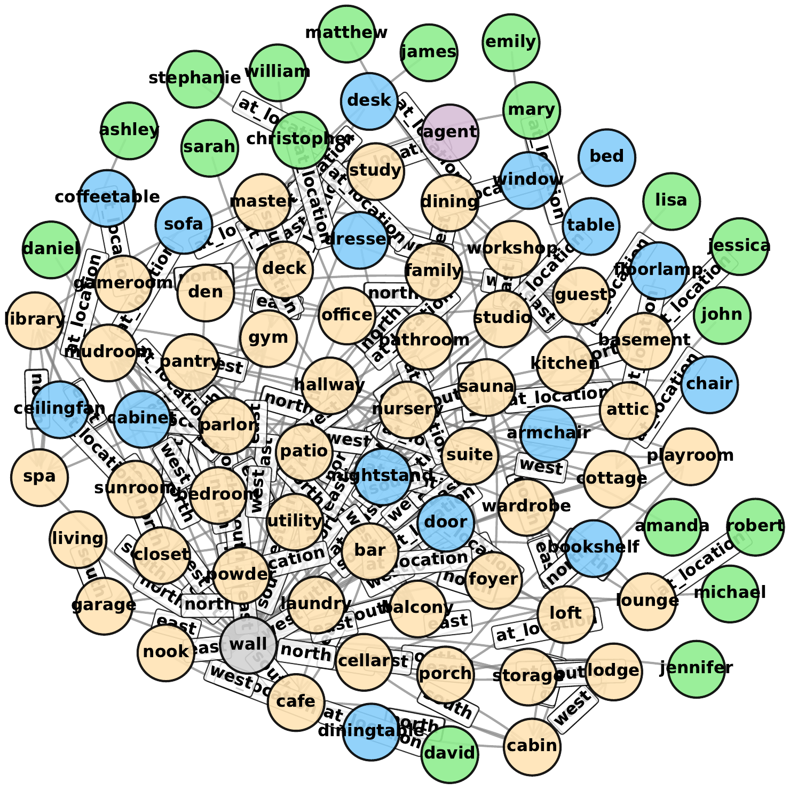

# The Room environments

The Room environments are Gymnasium-compatible partially observable environments
where an agent observes object-location events and answers questions about the
world state.

	
	

At the moment, there are three maintained versions of the Room environments.

## Overview

- [RoomEnv-v0](./README-v0.md): the original Room environment released with the Human-Like Memory Systems project.
- [RoomEnv-v1](./README-v1.md): the Explicit Memory version with a richer configuration and DES-based setup.
- [RoomEnv-v3](./README-v3.md): the RoomKG benchmark with deterministic object movement, periodic inner walls, and fixed question count.

## Project pages for work that uses the Room environments

- ["A Machine With Human-Like Memory Systems"](https://humem.ai/research/human-like-memory-systems)
- ["A Machine with Short-Term, Episodic, and Semantic Memory Systems"](https://humem.ai/research/explicit-memory)
- ["A Neurosymbolic Benchmark for Temporal Knowledge-Graph Memory in Partially Observable Environments"](https://humem.ai/research/roomkg-baselines)
- ["Short-Term-to-Long-Term Memory Transfer for Knowledge Graphs under Partial Observability "](https://humem.ai/research/kg-memory-transfer)
